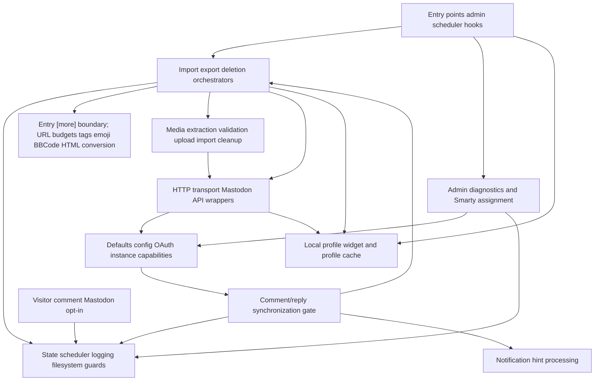

# 03 — Function-to-Process Matrix

This matrix links implementation functions to the process map. It is intentionally change-oriented: before editing a function, check the process, state areas and regression focus in the same row.

| Function(s)                                                                                                                                                                                                                                                                                                                                                                      | Process              | Responsibility                                                                                                                                             | State/API touched                                                                                  | Important side effects                                                                                                                                                                  | Regression focus                                               |
| -------------------------------------------------------------------------------------------------------------------------------------------------------------------------------------------------------------------------------------------------------------------------------------------------------------------------------------------------------------------------------- | -------------------- | ---------------------------------------------------------------------------------------------------------------------------------------------------------- | -------------------------------------------------------------------------------------------------- | --------------------------------------------------------------------------------------------------------------------------------------------------------------------------------------- | -------------------------------------------------------------- |
| `smarty_modifier_is_external_url()`                                                                                                                                                                                                                                                                                                                                              | P14                  | Classifies comment author URLs as internal or external for frontend rendering.                                                                             | `fp_config[general][www]`, `BLOG_BASEURL`, comment URL                                             | External links receive `target="_blank"` while relative and configured blog-base URLs remain in the current tab.                                                                        | Comment author target-decision test                            |
| plugin_mastodon_maybe_sync                                                                                                                                                                                                                                                                                                                                                       | P1/P9                | Ordinary request scheduler entry point.                                                                                                                    | scheduler-state.json, sync.guard.json                                                              | May call content and deletion sync.                                                                                                                                                     | Scheduler tests                                                |
| plugin_mastodon_run_sync                                                                                                                                                                                                                                                                                                                                                         | P1/P2                | Main content sync orchestrator.                                                                                                                            | state.json, scheduler-state.json, sync.lock, rate-limit windows                                    | Calls remote-to-local then local-to-remote; writes stats and errors.                                                                                                                    | Manual/scheduled sync tests                                    |
| plugin_mastodon_sync_remote_to_local                                                                                                                                                                                                                                                                                                                                             | P3/P4/P4a            | Remote import coordinator.                                                                                                                                 | last_remote_status_id, last_remote_notification_id, entries_remote, comments_remote                | Fetches account statuses with privacy hardening when supported, notification hints and contexts.                                                                                        | Remote import/thread tests                                     |
| plugin_mastodon_sync_local_to_remote                                                                                                                                                                                                                                                                                                                                             | P5/P6/P7             | Local export coordinator.                                                                                                                                  | dirty entries/comments, mappings, media metadata                                                   | Creates/updates statuses and replies.                                                                                                                                                   | Local export/comment/media tests                               |
| plugin_mastodon_run_deletion_sync                                                                                                                                                                                                                                                                                                                                                | P9                   | Main deletion reconciliation coordinator.                                                                                                                  | deletions_pending, cursors, mappings, tombstones                                                   | Deletes remote statuses or local mappings; queues rechecks.                                                                                                                             | Deletion sync tests                                            |
| plugin_mastodon_delete_status                                                                                                                                                                                                                                                                                                                                                    | P9/API               | Deletes a Mastodon status.                                                                                                                                 | instance_info_json via capability helper                                                           | Adds or omits `delete_media`; retries without it for legacy failures.                                                                                                                   | delete_media fallback tests                                    |
| plugin_mastodon_instance_supports_account_statuses_exclude_direct / plugin_mastodon_account_statuses_exclude_direct_should_retry_without                                                                                                                                                                                                                                         | P3/API               | Capability check and rejection retry gate for the Mastodon 4.6 `exclude_direct` account-status parameter.                                                  | Cached/stored `/api/v2/instance` `api_versions` and version fallback; account-status HTTP response | Sends `exclude_direct` only when support is known; retries once without it for compatible 400/405/422 failures.                                                                         | Account-status privacy hardening tests                         |
| plugin_mastodon_instance_supports_status_delete_media                                                                                                                                                                                                                                                                                                                            | P9/API               | Capability check for the delete_media parameter.                                                                                                           | Cached/stored `/api/v2/instance` `api_versions` and version fallback                               | Returns true/false/null; never performs a network request during deletion sync.                                                                                                         | Version-specific delete tests                                  |
| plugin_mastodon_instance_supports_media_delete                                                                                                                                                                                                                                                                                                                                   | P9/API               | Capability check for unattached media DELETE cleanup.                                                                                                      | Cached/stored `/api/v2/instance` `api_versions` and version fallback                               | Returns true/false/null; never performs a network request during upload cleanup failure paths.                                                                                          | Media cleanup capability tests                                 |
| plugin_mastodon_instance_supports_status_media_attributes                                                                                                                                                                                                                                                                                                                        | P5/P7/API            | Capability check for media alt-text update in status edit.                                                                                                 | `/api/v2/instance` `api_versions`, version fallback and per-request failed cache                   | Controls reuse+media_attributes vs re-upload without repeated failed instance lookups.                                                                                                  | Media reuse/update tests                                       |
| plugin_mastodon_instance_document / plugin_mastodon_instance_document_api_version / plugin_mastodon_normalized_instance_version                                                                                                                                                                                                                                                  | P11/API              | Load compact instance snapshots and normalize capability evidence.                                                                                         | Runtime cache, saved options, APCu, `/api/v2/instance`, `api_versions[mastodon]`                   | Caches success, negatively caches failed live lookups per request and avoids `/api/v1/instance`.                                                                                        | Instance capability tests                                      |
| plugin_mastodon_prepare_entry_media_sync_plan                                                                                                                                                                                                                                                                                                                                    | P5/P7                | Decides none/upload/reuse for the selected local entry media.                                                                                              | Entry media signatures and remote media metadata                                                   | Calls media-family selection before comparing signatures.                                                                                                                               | Media signature/reuse tests                                    |
| plugin_mastodon_select_status_media_items                                                                                                                                                                                                                                                                                                                                        | P7                   | Applies Mastodon media-family policy before signatures/uploads.                                                                                            | Selected local media set; skipped-media diagnostics                                                | Chooses images first, otherwise one audio, otherwise one video.                                                                                                                         | Media-family selection tests                                   |
| plugin_mastodon_upload_media_items                                                                                                                                                                                                                                                                                                                                               | P7/API               | Uploads media through `/api/v2/media` and polls if necessary.                                                                                              | rate-limit window, instance limits                                                                 | Returns media IDs or failure details.                                                                                                                                                   | Upload/processing tests                                        |
| plugin_mastodon_cleanup_uploaded_media                                                                                                                                                                                                                                                                                                                                           | P7/API               | Deletes uploaded but unattached media after post/update failure.                                                                                           | media IDs from current run                                                                         | Skips known-unsupported servers; otherwise calls `DELETE /api/v1/media/:id`.                                                                                                            | Cleanup and capability tests                                   |
| plugin_mastodon_collect_local_entry_media                                                                                                                                                                                                                                                                                                                                        | P7                   | Extracts images/galleries/audio/video from FlatPress content.                                                                                              | FlatPress entry body and companion plugin formats                                                  | Builds candidate local media descriptors.                                                                                                                                               | Local media extraction tests                                   |
| plugin_mastodon_build_entry_status_text                                                                                                                                                                                                                                                                                                                                          | P5                   | Builds Mastodon text from the entry body before the first [more], then applies the instance/URL budget.                                                    | Entry title, More-limited body, full-entry tags, URL budget, instance limits                       | Adds permalink and hashtag footer.                                                                                                                                                      | Text/tag/URL tests                                             |
| plugin_mastodon_build_comment_status_text                                                                                                                                                                                                                                                                                                                                        | P6                   | Builds Mastodon reply text from FlatPress comment.                                                                                                         | Comment author/body, public comment URL                                                            | Localizes and converts text/emoji.                                                                                                                                                      | Comment export tests                                           |
| plugin_mastodon_status_text_url_spans / plugin_mastodon_status_text_length / plugin_mastodon_limit_status_text                                                                                                                                                                                                                                                                   | P5/P6                | Apply Mastodon-compatible URL placeholder budgeting before truncating status text.                                                                         | Plain status text and `configuration.statuses.characters_reserved_per_url`                         | Treats trailing sentence punctuation as normal text so the server-side 500-character validator is not exceeded by URL-adjacent commas or full stops.                                    | URL punctuation-budget regression tests                        |
| plugin_mastodon_import_remote_entry                                                                                                                                                                                                                                                                                                                                              | P3/P8/P9             | Imports a remote entry unless its mapped local entry was deleted.                                                                                          | Remote status JSON                                                                                 | Writes entry, media, tags, mappings and the imported status source footer built from `Status.url`.                                                                                      | Remote entry import tests                                      |
| plugin_mastodon_imported_status_footer_bbcode                                                                                                                                                                                                                                                                                                                                    | P3                   | Builds the imported Mastodon status source footer BBCode.                                                                                                  | Mastodon `Status.url`                                                                              | Emits `[url=... target=_blank rel="nofollow noopener noreferrer"]Mastodon[/url]` for the single toot/status.                                                                            | Status-footer target tests                                     |
| plugin_mastodon_import_remote_comment / plugin_mastodon_protect_missing_local_exported_comment_by_remote_id                                                                                                                                                                                                                                                                      | P4/P8/P9             | Imports a remote reply only after enforcing local-deletion ownership.                                                                                      | Remote context descendant, `comments_remote`, targeted comment shard                               | Recreates a pending-delete tombstone for a missing `source=local` file and refuses stale import without loading all shards.                                                             | Partial-sync and bypass-hook tests                             |
| plugin_mastodon_fetch_reply_notifications / plugin_mastodon_process_remote_reply_notifications                                                                                                                                                                                                                                                                                   | P4a                  | Polls mention notifications and prioritizes old-thread reply hints.                                                                                        | notifications API, last_remote_notification_id, comments_remote                                    | Directly imports mapped-parent replies or spends the old-thread context budget.                                                                                                         | Notification hint tests                                        |
| plugin_mastodon_process_pending_comment_remote_rechecks                                                                                                                                                                                                                                                                                                                          | P4/P9                | Retries remote reply descendant checks later.                                                                                                              | pending_comment_remote_rechecks                                                                    | Imports or clears queued rechecks.                                                                                                                                                      | Pending recheck tests                                          |
| plugin_mastodon_state_read / plugin_mastodon_state_write                                                                                                                                                                                                                                                                                                                         | All sync processes   | Load and persist full synchronization state.                                                                                                               | state.json                                                                                         | Normalize defaults and write scheduler summary.                                                                                                                                         | State/scheduler tests                                          |
| plugin_mastodon_scheduler_state_read / plugin_mastodon_scheduler_state_write                                                                                                                                                                                                                                                                                                     | P1/P12               | Compact status summary optimized for normal requests.                                                                                                      | scheduler-state.json                                                                               | Avoids loading huge state files in common case.                                                                                                                                         | Compact scheduler tests                                        |
| `plugin_mastodon_rate_limit_guard_start()` / `plugin_mastodon_rate_limit_acquire()` / `plugin_mastodon_rate_limit_guard_stop()`                                                                                                                                                                                                                                                  | P1/P2/P7/P9          | Local request budget and remote rate-limit guard.                                                                                                          | rate-limit-windows.json and runtime globals                                                        | Blocks expensive calls with visible errors.                                                                                                                                             | Budget/rate-limit tests                                        |
| plugin_mastodon_oauth_scopes                                                                                                                                                                                                                                                                                                                                                     | P11                  | Chooses OAuth scopes for app registration/authorization.                                                                                                   | oauth_registered_scopes, discovery metadata                                                        | Prefers profile plus notifications on current servers and keeps existing legacy clients stable.                                                                                         | OAuth scope tests                                              |
| plugin_mastodon_head / plugin_mastodon_widget / profile-cache helpers                                                                                                                                                                                                                                                                                                            | P13                  | Loads the versioned widget stylesheet and renders the compact Mastodon widget from local public cache only.                                                | profile/profile.json, profile/avatar.*, res/mastodon.css                                           | Refreshes the cache from `plugin_mastodon_run_sync()` even in one-way export mode; widget render performs no HTTP request or inline CSS output.                                         | Widget cache/render/CSS/sync tests                             |
| plugin_mastodon_admin_assign                                                                                                                                                                                                                                                                                                                                                     | P12/P2/P9/P11        | Admin controller and diagnostics provider.                                                                                                                 | options, state, scheduler-state, manual actions                                                    | Assigns Smarty variables and triggers manual operations.                                                                                                                                | Admin assignment tests                                         |
| plugin_mastodon_on_entry_saved/deleted                                                                                                                                                                                                                                                                                                                                           | P10                  | FlatPress core hook handlers for entry changes.                                                                                                            | state.json, remote-write guard                                                                     | Marks dirty or deletion-pending.                                                                                                                                                        | Dirty/deletion hook tests                                      |
| plugin_mastodon_normalize_disable_comment_reply_sync / plugin_mastodon_should_sync_comments_and_replies                                                                                                                                                                                                                                                                          | P2b/P4/P4a/P6/P9/P10 | Central option gate for all comment/reply synchronization boundaries.                                                                                      | plugin options, dirty_comments, comments_remote, pending rechecks                                  | Keeps entry sync active while blocking local comment export, remote reply import and reply deletion follow-ups.                                                                         | Comment/reply disable tests                                    |
| plugin_mastodon_comment_to_reply_optin_required / plugin_mastodon_optin_comment_to_reply                                                                                                                                                                                                                                                                                         | P2c/P6               | Public comment-form opt-in display for Mastodon/Fediverse reply export.                                                                                    | plugin options, frontend language strings, submitted POST value                                    | Shows the short visitor notice only while local comments may actually be exported and restores `checked` after unrelated validation errors; no validation error blocks local comments.  | Opt-in display and hook-signature tests                        |
| plugin_mastodon_state_comment_reply_optins / plugin_mastodon_state_set_comment_reply_optin / plugin_mastodon_state_finalize_comment_reply_optin / plugin_mastodon_state_prune_orphaned_pending_comment_reply_optins / plugin_mastodon_local_comment_from_authenticated_author / plugin_mastodon_local_comment_export_allowed / plugin_mastodon_local_comment_export_grant_source | P2c/P6/P10           | State-backed visitor opt-in plus stored-`LOGGEDIN` authenticated export grant, including credential-deferred and CommentCenter-pending saves.              | comment_reply_optins, optional pending-file basename, comments, dirty_comments                     | Allows new local comment exports only with an explicit visitor/authenticated grant or existing mapping; finalizes approved pending grants and removes rejected/orphaned pending grants. | Opt-in state/export-guard, CommentCenter E2E and cleanup tests |
| plugin_mastodon_on_comment_saved/deleted                                                                                                                                                                                                                                                                                                                                         | P9/P10               | FlatPress core hook handlers for comment changes.                                                                                                          | state.json, remote-write guard                                                                     | Immediately tombstones deleted exported comments, preserves their mapping for remote deletion, or records imported replies as local ignores.                                            | Dirty/deletion and partial-sync tests                          |
| plugin_mastodon_state_comment_mapping_conflict / plugin_mastodon_state_set_comment_mapping                                                                                                                                                                                                                                                                                       | P4/P6/P8/P9          | Enforces one-to-one ownership between a Mastodon reply ID and one local comment.                                                                           | `comments`, `comments_remote`, one targeted conflict shard                                         | Rejects conflicting owners and removes an obsolete reverse ID during a legitimate remap of the same local comment.                                                                      | Mapping conflict/remap tests                                   |
| `plugin_mastodon_download_budget_start()`                                                                                                                                                                                                                                                                                                                                        | P1/P2/P8             | Reset byte/request counters and the import error marker.                                                                                                   | Request-local globals.                                                                             | Resets shared media budget once per content run.                                                                                                                                        | Run-budget reset tests.                                        |
| `plugin_mastodon_download_limit()`                                                                                                                                                                                                                                                                                                                                               | P8                   | Read configured image/AV/total/request limits.                                                                                                             | Central conditional constants.                                                                     | No I/O; positive safety limits.                                                                                                                                                         | Download boundary tests.                                       |
| `plugin_mastodon_download_write()`                                                                                                                                                                                                                                                                                                                                               | P8                   | Account for chunks and write within limits.                                                                                                                | Shared byte counter and staging file.                                                              | Counts rejected chunks; never writes an oversized chunk.                                                                                                                                | Exact/oversized/total-budget transport tests.                  |
| `plugin_mastodon_media_origin()` / `plugin_mastodon_media_redirect()`                                                                                                                                                                                                                                                                                                            | P8                   | Validate HTTP(S) origins and resolve redirects.                                                                                                            | Media URLs.                                                                                        | Origin changes control credential stripping.                                                                                                                                            | Invalid URL and redirect credential tests.                     |
| `plugin_mastodon_download_to_file()`                                                                                                                                                                                                                                                                                                                                             | P8                   | Stream bounded media downloads with explicit redirects.                                                                                                    | Staging files and shared run budget.                                                               | Removes partial files and returns path/empty body.                                                                                                                                      | cURL/stream transport and retry tests.                         |
| `plugin_mastodon_probe_video()` / `plugin_mastodon_video_rate()` / `plugin_mastodon_validate_video_metadata()`                                                                                                                                                                                                                                                                   | P5/P7                | Probe/parse/check video dimensions and frame rate.                                                                                                         | Request-local metadata cache, advertised instance limits.                                          | Bounded optional local process; may reject video before upload.                                                                                                                         | Metadata fixture and unavailable-tool fallback tests.          |
| `plugin_mastodon_refresh_instance_if_due()`                                                                                                                                                                                                                                                                                                                                      | P1/P2/P11            | Refresh missing/stale limits with failure cooldown.                                                                                                        | Cached instance options and request cache.                                                         | May call `/api/v2/instance` at content-run startup.                                                                                                                                     | Fresh/stale/error instance refresh tests.                      |
| `plugin_mastodon_memory_limit_bytes()` / `plugin_mastodon_multipart_memory_error()` / `plugin_mastodon_build_multipart_body()`                                                                                                                                                                                                                                                   | P7/API               | Parse PHP limits and preflight/build the fallback request body.                                                                                            | PHP memory headroom, constants and local files.                                                    | Rejects incomplete/oversized bodies before HTTP transport.                                                                                                                              | Multipart memory preflight tests.                              |

CommentCenter compatibility is split deliberately: `plugin_mastodon_on_commentcenter_comment_logged()` records the visitor opt-in grant and portable pending-file basename while the comment is only pending; `plugin_mastodon_on_comment_saved()` finalizes that marker and queues the approved comment; `plugin_mastodon_on_commentcenter_comment_discarded()` removes grants for intentionally rejected pending records. `plugin_mastodon_state_prune_orphaned_pending_comment_reply_optins()` is a bounded fallback for files removed outside the normal CommentCenter action. With CommentCenter disabled, the direct `comment_saved` path remains sufficient.

### Entry deletion ownership at the import boundary

`plugin_mastodon_import_remote_entry()` also enforces P9 ownership: a reverse-mapped
entry with no local file is skipped before HTML/media work or hash comparison. It leaves the
mapping available to `plugin_mastodon_run_deletion_sync()`. This boundary check covers
manual filesystem deletion without loading all comment shards or adding API requests.

### Fixed entry-deletion scheduling

| Helper                                                  | Process | Contract                                                                          |
| ------------------------------------------------------- | ------- | --------------------------------------------------------------------------------- |
| `plugin_mastodon_state_queue_local_entry_deletion()`    | P9/P10  | Record first per-entry UTC deadline without resetting it.                         |
| `plugin_mastodon_state_local_entry_deletion_deadline()` | P1/P9   | Read earliest queue deadline or compact scheduler scalar.                         |
| `plugin_mastodon_state_schedule_content_deletions()`    | P1/P2   | Retain entry deadlines and retry barriers through content completion.             |
| `plugin_mastodon_scheduled_job()`                       | P1/P9   | Choose due fixed-entry work before a daily content job, subject to retry backoff. |

The content path passes an optional preservation flag through
`plugin_mastodon_state_write_with_last_error()` to
`plugin_mastodon_state_write()`. That write merges newer committed local-entry
markers under the state-write lock. Successful deletion writes still remove completed markers.

## Function families

## Change impact examples

| Change area                  | First functions to inspect                                                                                                             | State to inspect                                | Tests to inspect                                                      |
| ---------------------------- | -------------------------------------------------------------------------------------------------------------------------------------- | ----------------------------------------------- | --------------------------------------------------------------------- |
| Mastodon delete behavior     | `plugin_mastodon_delete_status()`, `plugin_mastodon_run_deletion_sync()`                                                               | `deletions_pending`, cursors, tombstones        | Delete fallback and deletion sync tests                               |
| Media alt text update        | `plugin_mastodon_prepare_entry_media_sync_plan()`, `plugin_mastodon_status_media_attributes()`, `plugin_mastodon_update_status()`      | entry media signatures, `remote_media`          | Media reuse and description update tests                              |
| Remote reply import          | `plugin_mastodon_import_remote_comment()`, `plugin_mastodon_protect_missing_local_exported_comment_by_remote_id()`                     | `comments_remote`, tombstones, pending rechecks | Partial-sync, reply tree and tombstone tests                          |
| Comment mapping ownership    | `plugin_mastodon_state_comment_mapping_conflict()`, `plugin_mastodon_state_set_comment_mapping()`                                      | `comments`, `comments_remote`                   | Conflict rejection and remap cleanup tests                            |
| Scheduler performance        | `plugin_mastodon_maybe_sync()`, scheduler-state helpers                                                                                | `scheduler-state.json`, large `state.json`      | Compact scheduler/large state tests                                   |
| OAuth scopes                 | `plugin_mastodon_oauth_scopes()`, discovery helpers                                                                                    | options `oauth_registered_scopes`               | Scope discovery tests                                                 |
| Profile widget               | `plugin_mastodon_widget()`, `plugin_mastodon_refresh_profile_cache_for_sync()`, `plugin_mastodon_refresh_profile_cache_from_account()` | `profile/profile.json`, local avatar file       | Widget cache/render/sync tests                                        |
| Text conversion              | BBCode/HTML/text helper functions                                                                                                      | usually no state                                | HTML/BBCode/URL/tag/emoji tests                                       |
| Entry More boundary          | `plugin_mastodon_build_entry_status_text()`                                                                                            | No new state; full-content hash is retained     | More boundary, suffix, budget, version-cache and POST/PUT regressions |
| URL-adjacent punctuation     | `plugin_mastodon_status_text_url_spans()`, `plugin_mastodon_status_text_length()`, `plugin_mastodon_limit_status_text()`               | None                                            | URL punctuation-budget tests                                          |
| Comment shards and migration | `plugin_mastodon_state_load_comment_shard_into()`, `plugin_mastodon_state_write_comment_shards()`                                      | Shards, backup and `comments_remote`            | Partial-read, migration and repair tests.                             |
| Admin/CLI maintenance        | `plugin_mastodon_admin_assign()`, `plugin_mastodon_cli_comment_shard_maintenance()`                                                    | Diagnostic result and repaired main index       | Maintenance UI/CLI tests.                                             |

For bounded downloads, metadata, instance refresh and fallback uploads, use
the media rows in the main matrix. [API/media rules](04-API-Compatibility.md#media-safety-responsibilities)
define constraints; [the helper catalog](07-Function-Organigram.md#media-safety-helper-catalog)
lists every media-safety function.

The entry import boundary owns deleted-entry protection; a missing reverse-mapped
local entry remains owned by deletion reconciliation. See
[the ownership matrix](02-State-Model.md#state-ownership-rules) before changing
queue or mapping helpers.

## Reading guidance

- Start with orchestrators (`run_sync`, `sync_remote_to_local`, `sync_local_to_remote`, `run_deletion_sync`).
- Then follow the helper family that owns the state you need to change.
- Avoid adding direct file or HTTP behavior in deep conversion helpers; keep side effects in orchestrators or API wrappers.
- Widget callbacks must not make HTTP calls; refresh local profile cache from authenticated `plugin_mastodon_run_sync()`/account-verification paths.

## Side-effect boundaries and compatibility rules

| Rule                                                                                               | Reason                                                                  |
| -------------------------------------------------------------------------------------------------- | ----------------------------------------------------------------------- |
| Keep pure text/BBCode/URL conversion helpers free of file and HTTP side effects.                   | They are heavily tested and should remain deterministic.                |
| Keep Mastodon endpoint strings centralized in API wrapper functions.                               | Makes fallback and budget behavior auditable.                           |
| Use mapping helpers for `entries`, `entries_remote`, `comments` and `comments_remote`.             | Enforces reverse-index consistency and rejects duplicate remote owners. |
| Do not load full `state.json` in ordinary request fast paths when `scheduler-state.json` is fresh. | Required for large FlatPress installations and shared hosting.          |
| Do not introduce PHP syntax newer than PHP 7.2.                                                    | Plugin target includes PHP 7.2 through 8.5.                             |
| Avoid dynamic shapes that PHPStan Level 5 cannot follow without normalization.                     | Normalize arrays before reads; use clear guards for mixed values.       |
| Keep Smarty-facing admin values as simple arrays/scalars.                                          | Maintains compatibility with Smarty 4.x/5.x templates.                  |
| Add regression tests for any new long-lived state key.                                             | State bugs are often delayed until a later scheduled run.               |

## Implementation files after modularization

The entry point and internal modules share one plugin lifecycle. The module
map below complements the function/process matrix above. Names, signatures and
process assignments were retained by the modularization. See
[function counts and locations](07-Function-Organigram.md#function-count) and
[historical modularization evidence](05-Regression-Test-Matrix.md#modularization-verification).

### Entry point and loading behavior

[`plugin.mastodon.php`](../plugin.mastodon.php) continues to define all existing
plugin constants conditionally in its opening block. An explicit list of local
`require_once` statements then loads the internal function modules. Hooks,
the widget, and admin panel actions are registered only in the main file.

The modules provide declarations. Loading them does not start synchronization,
refresh caches, migrate state, or issue HTTP requests. Both admin classes are
loaded through `inc/admin-actions.php` inside the original
`class_exists('AdminPanelAction')` guard. This check remains after widget
registration and does not introduce an additional autoload lookup. The CLI
maintenance function remains available without the admin classes. No new
autoloader or feature-specific lazy loading has been introduced.

### Module responsibilities

| File                                                | Responsibility                                                                                                    |
| --------------------------------------------------- | ----------------------------------------------------------------------------------------------------------------- |
| [`inc/text.php`](../inc/text.php)                   | Text, BBCode/HTML, URLs, tags, emoticons, character budgets, and status text builders.                            |
| [`inc/profile.php`](../inc/profile.php)             | Head output, profile/avatar cache, and the widget. Rendering uses local data only.                                |
| [`inc/admin.php`](../inc/admin.php)                 | Admin input handling, language strings, instance diagnostics, and Smarty assignments.                             |
| [`inc/admin-actions.php`](../inc/admin-actions.php) | Both action classes, loaded conditionally at the original registration point.                                     |
| [`inc/runtime.php`](../inc/runtime.php)             | Request cache, FlatPress configuration/time conversion, file I/O, APCu, logging, guards, and budgets.             |
| [`inc/options.php`](../inc/options.php)             | Options, normalization, secrets, feature gates, and companion plugin detection.                                   |
| [`inc/api.php`](../inc/api.php)                     | HTTP/multipart transport, OAuth, instance information, capabilities, and the status API.                          |
| [`inc/media-safety.php`](../inc/media-safety.php)   | Existing bounded downloads, multipart memory checks, video metadata, and instance refresh. Retained unchanged.    |
| [`inc/media.php`](../inc/media.php)                 | Media selection, validation, signatures, upload/polling, import, and cleanup.                                     |
| [`inc/state.php`](../inc/state.php)                 | State, shards, mappings, write lock, migration, scheduler summary, and CLI maintenance.                           |
| [`inc/local-events.php`](../inc/local-events.php)   | Local events, dirty tracking, feedback-loop protection, and comment opt-in/CommentCenter handling.                |
| [`inc/deletion.php`](../inc/deletion.php)           | Deletion reconciliation and reply-descendant rechecks.                                                            |
| [`inc/sync.php`](../inc/sync.php)                   | Content windows, local candidates, import/export, notifications, context rotation, and the scheduler entry point. |

### Behavior boundaries for module changes

The state-write lock, sync lock, budgets, caches and reference parameters are
shared across modules. Moving a declaration must preserve its callers, guards
and side effects. Splitting files alone does not demonstrate a performance
improvement; OPcache remains optional.

- The `[more]` text boundary leaves full-entry media, tags and change hashes intact; see [the text pipeline](06-Process-Flow.md#21-local-to-remote-status-text-pipeline).
- The fresh scheduler fast path still uses compact state without a full mapping read; see [scheduler fields](02-State-Model.md#compact-scheduler-fields).
- One-way mode, comment grants, tombstones and fixed deletion deadlines retain their state contracts; see [state ownership](02-State-Model.md#state-ownership-rules) and the associated lifecycle sections.
- cURL/stream fallback, optional extensions and ffprobe keep their existing validation behavior; see [media safety](04-API-Compatibility.md#media-safety-responsibilities).
